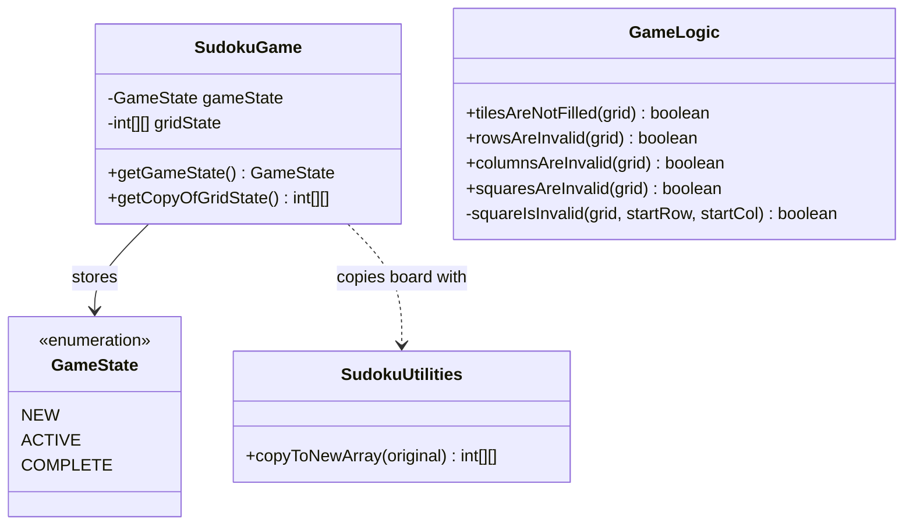

# Java Sudoku

A Sudoku project I'm building step by step in Java. The current version
represents a 9×9 board and checks its rows, columns, and 3×3 boxes for
duplicate numbers.

## Current features

- Represents empty cells with `0`.
- Copies the board when creating a game and when returning its grid,
  so outside code can change its own array without changing the saved board.
- Detects empty cells and checks rows, columns, and boxes for duplicates.
  Empty cells are skipped during duplicate checks.

## Class structure

`SudokuGame` stores the board and the game state. `SudokuUtilities` copies
the board. `GameLogic` takes a grid and checks it against the Sudoku rules.

## Next step

Combine the existing checks to determine whether a board is complete.

## Acknowledgments

This project is based on the `JavaDesktopSudoku` example from the
*Working Class Java* course.